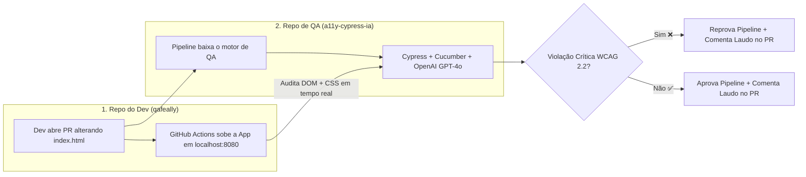

# ☕ QAfé Academy (`qafeally`) — Repositório do Sistema (Front-end / Dev)

Este repositório contém **exclusivamente o código-fonte de Front-end** (`index.html` e `index.css`) da página de autenticação da **QAfé Academy**, além da configuração da esteira de CI/CD no GitHub Actions.

---

## 🏛️ Arquitetura "Mundo Real" — Separação Total entre Dev e QA

Em um ambiente corporativo real com **Governança de Qualidade (Shift-Left Quality Gate)**, o código dos testes automatizados **NÃO fica dentro do repositório do desenvolvedor**.

Por isso, esta solução é dividida em **2 repositórios independentes**:

1. 💻 **Repositório do Sistema (Front-end / Dev):** [`AngeloFDiasGTech/qafeally`](https://github.com/AngeloFDiasGTech/qafeally) *(este repositório)*
   - Contém apenas o código da aplicação (`index.html` e `index.css`) onde os desenvolvedores criam novas features e abrem Pull Requests.
   - Não possui pasta `cypress/`, `package.json` de testes nem scripts de auditoria. O desenvolvedor não precisa configurar (e nem consegue burlar) o teste.
2. 🛡️ **Repositório do Motor de Auditoria (QA):** [`AngeloFDiasGTech/a11y-cypress-ia`](https://github.com/AngeloFDiasGTech/a11y-cypress-ia)
   - Mantido pelo time de Qualidade (QA).
   - Contém o **Cypress**, as features em **Cucumber (BDD)** e a integração com a **OpenAI (`gpt-4o`)** atuando como Auditor Sênior da **WCAG 2.2**.

---

## 🎤 Roteiro da Demonstração ao Vivo na Palestra

O projeto foi desenhado em **3 atos** para demonstrar o problema em produção e como a esteira com **Cypress + Cucumber + IA** protege a `main`:

### 1️⃣ Ato 1: O Problema em Produção (`main` em `https://qafeally.angelofdiasg.tech/`)
A página inicialmente publicada na `main` contém **falhas críticas clássicas de acessibilidade** para serem auditadas ao vivo com **Google Lighthouse**, **WAVE** e **Leitor de Tela (NVDA / VoiceOver)**:
1. **Links vazios / sem nome acessível (`WCAG 4.1.2` / `2.4.4`):**
   - Link **"Blog"** no cabeçalho com `Blog` e sem `aria-label`.
   - Links de **Instagram (`@oanjoeducador`), YouTube e LinkedIn** no rodapé sem `aria-label` e com conteúdo interno em `aria-hidden="true"`. O leitor de tela anuncia apenas *"link, link, link"* e o WAVE/Lighthouse aponta **Empty Link**.
2. **Campo de formulário sem `<label>` (`WCAG 1.3.1` / `3.3.2`):**
   - Input `"Código de convite da turma"` sem `<label for="auth-coupon">` nem `aria-label`, dependendo apenas de `placeholder` (**Missing Form Label** no WAVE/Lighthouse).
3. **Baixo contraste severo (`WCAG 1.4.3`):**
   - Texto de instrução `#coupon-hint` com cor `#4a4a4a` sobre fundo `#222222` (razão de contraste ~1.6:1, muito abaixo do mínimo 4.5:1 — **Low Contrast** no WAVE/Lighthouse).
4. **Bloqueio de navegação por teclado (`WCAG 2.1.1`):**
   - Link `"Esqueci minha senha"` com `tabindex="-1"` e sem `href`, impossível de alcançar com a tecla `Tab`.

---

### 2️⃣ Ato 2: O Pull Request que Corrige Tudo e Passa no Quality Gate ✅ (`demo/pr-aprovado`)
Simula a entrega da correção completa de acessibilidade segundo a **WCAG 2.2 AA/AAA**:
1. Link **"Blog"** e links das **redes sociais no rodapé** com nome acessível descritivo (`aria-label`).
2. Campo **"Código de convite da turma"** com `<label for="auth-coupon">` explícito e dica vinculada via `aria-describedby="coupon-hint"`.
3. Dica do cupom com contraste elevado (`#e5e7eb` sobre `#222222`, contraste > 11:1).
4. Link **"Esqueci minha senha"** semântico, alcançável por teclado (`Tab`) e com indicador de foco visível.

🔗 **Links rápidos para abrir os PRs ao vivo na palestra:**
- **[Abrir PR Aprovado ao vivo (`ao-vivo/pr-aprovado`)](https://github.com/AngeloFDiasGTech/qafeally/compare/main...ao-vivo/pr-aprovado?expand=1)**
- *(Backup já executado e pronto na aba Pull Requests: `demo/pr-aprovado` — PR #2)*

---

### 3️⃣ Ato 3: Tentativa de Regressão Bloqueada pelo Quality Gate ❌ (`ao-vivo/pr-rejeitado` / `demo/pr-rejeitado`)
Simula um desenvolvedor tentando abrir um PR que introduz falhas críticas de acessibilidade (ou tenta subir um botão/campo sem acessibilidade):
- A pipeline executa o motor externo `a11y-cypress-ia` (Cypress 16.3.0 + Cucumber Badeball + OpenAI `gpt-4o`).
- A IA detecta as violações da WCAG 2.2, **comenta o laudo detalhado no PR** com sugestões de código e **bloqueia o botão de Merge** no GitHub!

🔗 **Links rápidos para abrir os PRs ao vivo na palestra:**
- **[Abrir PR Rejeitado ao vivo (`ao-vivo/pr-rejeitado`)](https://github.com/AngeloFDiasGTech/qafeally/compare/main...ao-vivo/pr-rejeitado?expand=1)**
- *(Backup já executado e pronto na aba Pull Requests: `demo/pr-rejeitado` — PR #1)*
