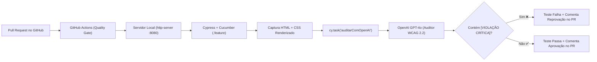

# 🛡️ QAfé Academy — Quality Gate de Acessibilidade com Cypress, Cucumber (BDD) e IA (OpenAI)

Este repositório demonstra como implementar **Shift-Left Accessibility** em um cenário de **mundo real** utilizando:
- **Cypress + Cucumber (BDD)** para testes estruturais e captura do DOM/CSS renderizados em tempo de execução.
- **OpenAI API (`gpt-4o`)** atuando como Auditor Sênior da **WCAG 2.2** dentro de uma Task do Node.js no Cypress (`cy.task('auditarComOpenAI')`).
- **GitHub Actions** como Quality Gate de Pull Requests:
  - Bloqueia ou aprova automaticamente o PR de acordo com o laudo da IA e a validação do Cypress.
  - Publica o laudo completo em Markdown diretamente como **comentário no Pull Request** e no **GitHub Job Summary**.

---

## 🏗️ Arquitetura da Solução



---

## ⚙️ Pré-requisitos e Configuração no GitHub

1. **Configurar a Secret da OpenAI no GitHub:**
   - No repositório do GitHub, acesse **Settings** > **Secrets and variables** > **Actions**.
   - Clique em **New repository secret**:
     - **Name:** `OPENAI_API_KEY`
     - **Secret:** `sk-...` (sua chave da API da OpenAI).

2. **Permissões do Workflow para Comentar no PR:**
   - O arquivo `.github/workflows/cypress-a11y.yml` já declara `pull-requests: write` e `issues: write`, permitindo que o `github-script` comente automaticamente o laudo da IA no PR.

---

## 💻 Como Executar Localmente

1. Instale as dependências:
   ```bash
   npm install
   ```

2. Defina sua chave da OpenAI no terminal:
   - **PowerShell (Windows):**
     ```powershell
     $env:OPENAI_API_KEY="sk-sua-chave-aqui"
     ```
   - **Linux / macOS:**
     ```bash
     export OPENAI_API_KEY="sk-sua-chave-aqui"
     ```

3. Execute o servidor + Cypress em modo Headless (mesmo comando da pipeline):
   ```bash
   npm run test:ci
   ```
   Ou se preferir abrir a interface visual do Cypress:
   ```bash
   # Terminal 1:
   npm run serve

   # Terminal 2:
   npm run test:ui
   ```

---

## 🎤 Roteiro para a Demonstração ao Vivo na Palestra

O repositório já possui **3 branches** preparadas para você abrir os Pull Requests ao vivo durante a palestra:

### 1️⃣ Branch Base (`main`) — Aplicação 100% Acessível
- Contém a página de Login da **QAfé Academy** seguindo a **WCAG 2.2**:
  - Skip Link (`WCAG 2.4.1`)
  - Indicador de foco visível de alto contraste 9.66:1 (`WCAG 2.4.7` / `2.4.11`)
  - Abas acessíveis com `role="tablist"`, `role="tab"`, `aria-selected` e `aria-controls`
  - Região de alerta dinâmica com `role="alert"` e `aria-live="polite"` (`WCAG 4.1.3`)
  - Links, botões e ícones com nomes acessíveis adequados (`WCAG 2.4.4` / `4.1.2`)

### 2️⃣ Cenário 1: Pull Request Rejeitado ❌ (`demo/pr-rejeitado`)
Simula um desenvolvedor enviando uma alteração na tela de login que **quebra a acessibilidade** (mas visualmente parece "funcionar" para quem enxerga e usa mouse):
1. **Link "Blog" invisível para leitores de tela (`WCAG 4.1.2` / `2.4.4`):** `<a href="..."><span aria-hidden="true">Blog</span></a>` — o leitor de tela anuncia apenas *"link"* sem dizer para onde vai.
2. **Campo de input "Código de Convite" sem `<label>` nem `aria-label` (`WCAG 1.3.1` / `3.3.2`):** usa apenas `placeholder`.
3. **Link "Esqueci minha senha" sem `href` e com `tabindex="-1"` (`WCAG 2.1.1`):** inacessível via navegação por teclado (`Tab`).

👉 **O que acontece ao abrir o PR `demo/pr-rejeitado` -> `main`:**
- O GitHub Actions sobe a aplicação, roda o Cypress com Cucumber e envia o HTML/CSS para o GPT-4o.
- A IA retorna `[VIOLAÇÃO CRÍTICA]` detalhando cada critério da WCAG 2.2 violado e como corrigir.
- O bot comenta o laudo completo no PR e **reprova o check da pipeline** ❌.

### 3️⃣ Cenário 2: Pull Request Aprovado ✅ (`demo/pr-aprovado`)
Simula a entrega da funcionalidade de **"Lembrar meu acesso por 30 dias"** e **"Esqueci minha senha"** construída com todas as boas práticas da WCAG 2.2:
1. Link **"Blog"** acessível para leitores de tela.
2. Checkbox **"Manter sessão ativa por 30 dias"** com `<label for="auth-remember">` explícito e texto de apoio vinculado via `aria-describedby`.
3. Link **"Esqueci minha senha"** semântico, alcançável por teclado (`Tab`) e com foco visível.

👉 **O que acontece ao abrir o PR `demo/pr-aprovado` -> `main`:**
- O GitHub Actions executa o Cypress + Cucumber + OpenAI.
- A IA retorna `[ACESSÍVEL]`, elogiando a estrutura semântica e os atributos ARIA.
- O bot comenta o laudo de aprovação no PR e **libera o merge na pipeline** ✅.
