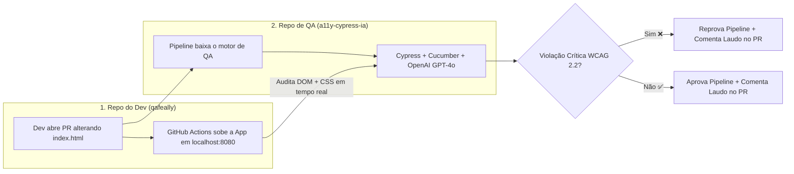

# ☕ QAfé Academy (`qafeally`) — Repositório do Sistema (Front-end / Dev)

Este repositório contém **exclusivamente o código-fonte de Front-end** (`index.html` e `index.css`) da página de autenticação da **QAfé Academy**, além da configuração da esteira de CI/CD no GitHub Actions.

---

## 🏛️ Arquitetura "Mundo Real" — Separação Total entre Dev e QA

Em um ambiente corporativo real com **Governança de Qualidade (Shift-Left Quality Gate)**, o código dos testes automatizados **NÃO fica dentro do repositório do desenvolvedor**.

Por isso, esta solução é dividida em **2 repositórios independentes**:

1. 💻 **Repositório do Sistema (Front-end / Dev):** [`AngeloFDiasGTech/qafeally`](https://github.com/AngeloFDiasGTech/qafeally) *(este repositório)*
   - Contém apenas o código da aplicação (`index.html` e `index.css`) onde os desenvolvedores criam novas features e abrem Pull Requests.
   - Não possui pasta `cypress/`, `package.json` de testes nem scripts de auditoria. O desenvolvedor não precisa configurar (e nem consegue burlar) o teste.
2. 🛡️ **Repositório do Motor de Auditoria (QA):** [`AngeloFDiasGTech/a11y-cypress-ia`](https://github.com/AngeloFDiasGTech/a11y-cypress-ia)
   - Mantido pelo time de Qualidade (QA).
   - Contém o **Cypress**, as features em **Cucumber (BDD)** e a integração com a **OpenAI (`gpt-4o`)** atuando como Auditor Sênior da **WCAG 2.2**.

---

## 🎤 Roteiro da Demonstração ao Vivo na Palestra

O repositório já conta com **3 branches** prontas para demonstrar o fluxo completo de um desenvolvedor abrindo Pull Requests e sendo auditado pelo motor externo de QA:

### 1️⃣ Branch Principal (`main`) — Produção 100% Acessível
Contém a tela de login da **QAfé Academy** construída com conformidade **WCAG 2.2 AA/AAA**:
- Skip Link (`WCAG 2.4.1`)
- Foco visível de alto contraste 9.66:1 (`WCAG 2.4.7` / `2.4.11`)
- Abas com semântica `role="tablist"`, `role="tab"`, `aria-selected` e `aria-controls`
- Mensagens de feedback com `role="alert"` e `aria-live="polite"` (`WCAG 4.1.3`)

### 2️⃣ Pull Request Rejeitado ❌ (`demo/pr-rejeitado`)
Simula um desenvolvedor entregando o campo de **"Código de convite"** e o link **"Esqueci minha senha"**, mas introduzindo **3 falhas críticas de acessibilidade**:
1. **Link "Blog" oculto para leitores de tela (`WCAG 4.1.2` / `2.4.4`):** `<a href="...">Blog</a>` — o leitor de tela anuncia apenas *"link"*.
2. **Input de Cupom sem `<label>` nem `aria-label` (`WCAG 1.3.1` / `3.3.2`):** depende apenas de `placeholder`.
3. **Link "Esqueci minha senha" inacessível por teclado (`WCAG 2.1.1`):** usa `tabindex="-1"` e não possui atributo `href`.

🔗 **[Clique aqui para abrir o PR Rejeitado ao vivo](https://github.com/AngeloFDiasGTech/qafeally/compare/main...demo/pr-rejeitado?expand=1)**

### 3️⃣ Pull Request Aprovado ✅ (`demo/pr-aprovado`)
Simula o desenvolvedor entregando a mesma feature seguindo as diretrizes da **WCAG 2.2**:
1. Link **"Blog"** acessível para leitores de tela.
2. Campo **"Código de convite da turma"** com `<label for="auth-coupon">` explícito e dica vinculada via `aria-describedby="coupon-hint"`.
3. Link **"Esqueci minha senha"** semântico, alcançável por teclado (`Tab`) e com indicador de foco visível.

🔗 **[Clique aqui para abrir o PR Aprovado ao vivo](https://github.com/AngeloFDiasGTech/qafeally/compare/main...demo/pr-aprovado?expand=1)**
